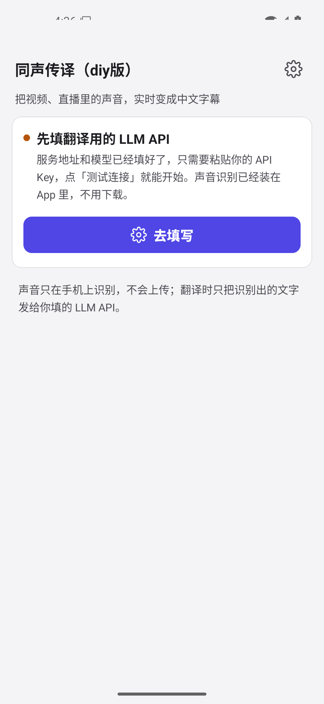
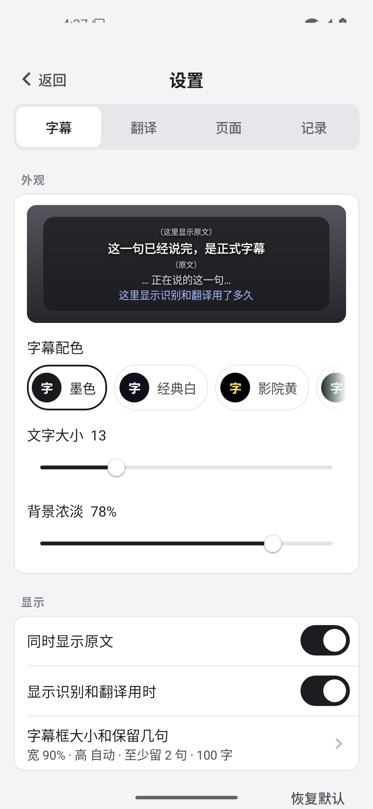
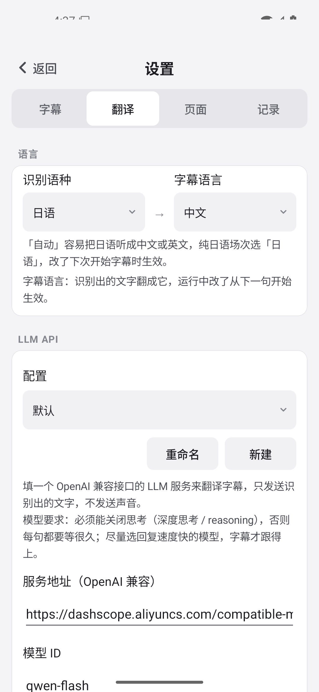
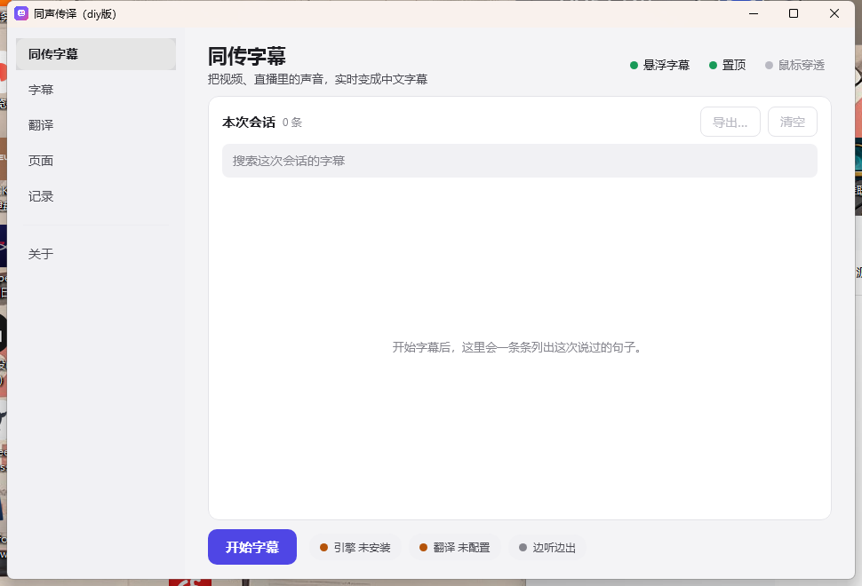
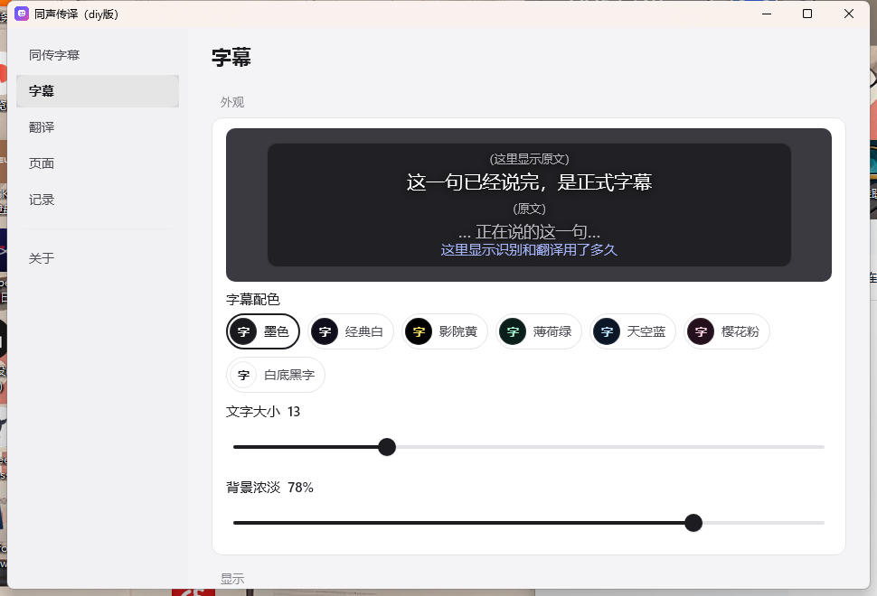
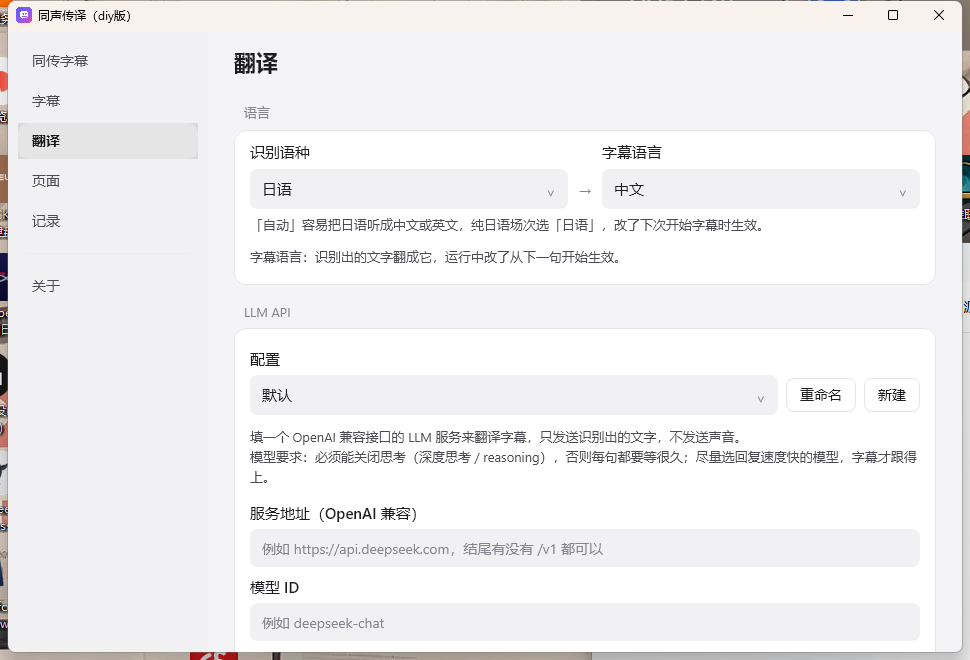

  

<h1 align="center">Simul Subtitle（同传字幕）</h1>

  Real-time floating translated subtitles for Japanese and English videos &amp; livestreams on Android and Windows. 
  100% on-device speech recognition · Bring Your Own LLM (BYOK) · Works on top of any app.

  <a href="README.md">中文</a> ·
  <a href="../../releases">Releases</a> ·
  <a href="docs/README.md">Technical Docs (Chinese)</a>

---

## Screenshots

<table>
  <tr><th colspan="3">Android</th></tr>
  <tr>
    <td align="center" valign="top"> Home</td>
    <td align="center" valign="top"> Settings · Subtitles</td>
    <td align="center" valign="top"> Settings · Translation</td>
  </tr>
  <tr><th colspan="3">Desktop (Windows)</th></tr>
  <tr>
    <td align="center" valign="top"> Home</td>
    <td align="center" valign="top"> Settings · Subtitles</td>
    <td align="center" valign="top"> Settings · Translation</td>
  </tr>
</table>

## Key Features

- **Works across your apps**: Watch Bilibili, YouTube, Twitch, browser streams, or local players. On Android, the app captures internal audio from any app that permits playback capture (DRM-protected streams excluded); on Windows, it captures system audio output directly without using a microphone.
- **Live drafts &amp; final subtitles**: Draft captions appear while someone is speaking and settle into a polished translation as soon as the sentence ends—or switch to final-only mode to save battery and tokens.
- **100% on-device speech recognition**: Ships with bundled ReazonSpeech and Silero VAD models (~78 MB). Nothing extra to download, and **your audio never leaves your device**.
- **Bring Your Own LLM (BYOK)**: Connect any OpenAI-compatible API endpoint (DeepSeek, Qwen, OpenRouter, etc.) with your own base URL, model ID, and API key. On first use, the app automatically probes and disables reasoning/thinking mode for low-latency streaming.
- **Translate into any language**: Built-in presets for Chinese, English, Japanese, and Korean, or choose **Custom…** (自己填…) to type any target language or dialect (e.g., Traditional Chinese, Cantonese, French, Spanish).
- **Scene context &amp; glossaries**: Includes a built-in *Bilibili VTuber Livestream* preset and lets you create custom scenes with background notes and a term glossary—or have your LLM generate domain terms automatically from your description.

## Get Started in Three Steps

> Note: The app's UI is currently in Chinese. Button labels below include both English meanings and their exact Chinese text.

1. **Configure your LLM API**: On first launch, tap **Start Captions** (开始字幕) on the home screen—it takes you straight to the page that is still missing, the **Translation** tab (翻译). Enter your OpenAI-compatible base URL, model ID, and API key, then tap **Test Connection** (测试连接).
2. **Grant permissions**:
   - **Android**: Allow internal audio capture and displaying over other apps when prompted. After granting the overlay permission in system settings, the start continues by itself.
   - **Windows**: No special permissions required.
3. **Start subtitles**: Pick the spoken language under **Translation → Language** (识别语种, Japanese by default), go back to **Home** and tap **Start Captions** (开始字幕). On Android, pick the target app in the system dialog; on desktop, it listens to all system playback immediately. Switch back to your video to watch with live subtitles.

### Phone layout

The Android app has five sections along the bottom—**Home** (首页), **Subtitles** (字幕), **Translation** (翻译), **Page** (页面), **Records** (记录)—with no settings dialog and no sub-pages:

| Section | What lives there |
|---|---|
| Home | This session's transcript (search / export / clear), the start button, and three status chips (engine / translation model / caption mode) |
| Subtitles | Look (preview, palette, size, opacity) and display (original text, timing, width, height, lines kept) |
| Translation | Language, LLM API, content type, segmentation, caption mode, translation check |
| Page | Theme, notifications, about (version and update check) |
| Records | Session logs, audio recording, the list of saved logs |

### Subtitle Overlay Controls

Controls work the same way via touch on Android or mouse click on desktop:

| Action | Effect |
|---|---|
| **Drag** | Move the floating subtitle window anywhere (including external displays on desktop) |
| **Tap / Click** | Show or hide the toolbar: font size, background opacity, live draft vs. final-only mode, original text &amp; latency stats toggle, lock, and stop |
| **Drag corner arrows** | Resize the subtitle box width and height while the toolbar is visible |
| **Lock** | Fix position and size to prevent accidental touches; tapping while locked only reveals an unlock button in the bottom-right corner |

Until you set a height, the box fits its text: in the lower half of the screen its bottom edge stays put and it grows upward, so the last line you are reading is never pushed away; in the upper half its top edge stays put and it grows downward. Whenever the lines have to move up (a new line pushes them, or an old sentence leaves), they slide smoothly instead of jumping.

## Installation

Download the latest package for your platform from the [Releases](../../releases) page.

### Android

- **Requirements**: Android 10 (API 29) or later, `arm64-v8a`.
- **Install**: Download the `.apk` from [Releases](../../releases) and open it on your phone (allow *Install unknown apps* when prompted).
- **In-app updates**: Since v0.4, the app checks for updates on launch and can download and install new releases directly. You can also check manually or disable auto-checks under **Page → About** (页面 → 关于).

### Windows

- **Requirements**: Windows 10 / 11, 64-bit (`x64`).
- **Run**: Download `Windows-SimulSub-x64.zip` from [Releases](../../releases), extract the folder anywhere, and run `SimulSub.exe` (portable, no installer needed).
- **First launch (unsigned binary)**: If Windows SmartScreen displays *"Windows protected your PC"*, click **More info** → **Run anyway**.
- **Background &amp; data**:
  - Captures audio from the default playback device via WASAPI loopback and automatically follows device switches (e.g., plugging in headphones).
  - Closing the main window keeps subtitles running in the system tray; right-click the tray icon and choose **Quit** (退出) to exit completely.
  - Network requests follow the system proxy and fall back to direct connections when a proxy cannot reach the target host.
  - Preferences and optional logs live in `%APPDATA%\SimulSub\`. API keys are encrypted with Windows DPAPI (bound to your Windows user account) in `keys.json`.

## FAQ

**Q: Why don't subtitles appear for certain apps on Android?**
Some apps (such as DRM-protected video players) block other apps from capturing their audio at the OS level. Desktop builds capture system output directly and do not have this limitation.

**Q: Which spoken languages are supported?**
**Japanese** and **English**. Selecting the matching source language on the home screen helps tailor the translation prompt.

**Q: Is my audio ever uploaded to the cloud?**
**No.** Speech-to-text runs locally on your phone or computer. Only the recognized text transcript is sent to the LLM API endpoint you configured. See [docs/privacy.md](docs/privacy.md) for details.

**Q: Which LLM model should I choose for translation?**
Pick a fast model whose reasoning/thinking mode can be disabled—otherwise thinking tokens add several seconds of delay to every sentence. The first time you connect a model, the app automatically tests and remembers the parameter needed to disable thinking.

## Acknowledgements

Simul Subtitle builds on these open-source projects:

- **[ReazonSpeech](https://github.com/reazon-research/ReazonSpeech)**: Japanese and English speech recognition ([reazonspeech-k2-v2-ja-en](https://huggingface.co/csukuangfj/reazonspeech-k2-v2-ja-en) exported for sherpa-onnx).
- **[sherpa-onnx](https://github.com/k2-fsa/sherpa-onnx)**: On-device speech recognition and voice activity detection runtime ([Silero VAD](https://github.com/snakers4/silero-vad)).

The optional **Smart Sentence Segmentation** and **Translation Verification** features use **[TypeSafe Jev](https://typesafe.ai)**—a closed-source commercial cloud service for structured decisions (disabled by default; billed at ~$0.04 per hour of speech when using a paid endpoint; see [docs/jev.md](docs/jev.md)).

---

License: [MIT](LICENSE). Bundled models and third-party libraries remain under their respective licenses.
